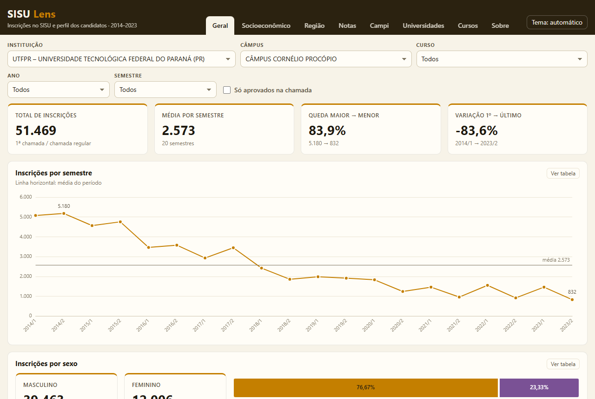
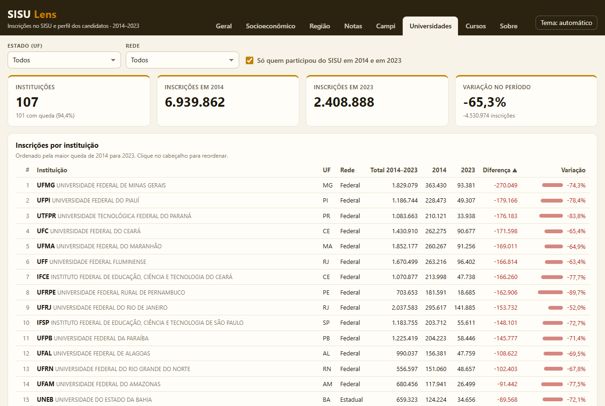
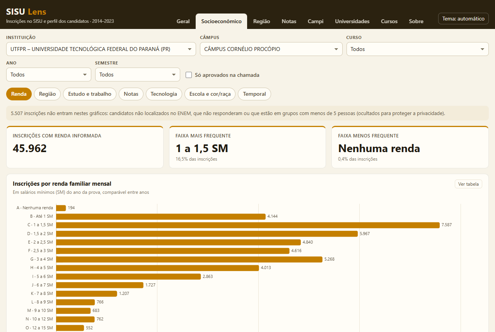

# SISU Lens

Painel aberto sobre as inscrições no **SISU** de 2014 a 2023 e o perfil socioeconômico de quem se
inscreveu, declarado no **ENEM**. Cobre todas as 151 instituições participantes e 51,2 milhões de
inscrições, com os dados consultados direto no navegador, sem servidor.

É a evolução do meu Trabalho de Conclusão de Curso, *"Análise de dados: um estudo sobre o número de
inscritos na UTFPR-CP"* (Engenharia de Computação, UTFPR – Cornélio Procópio, 2026, orientação do
Prof. Dr. Francisco Pereira Junior). O TCC estudou um câmpus; o SISU Lens abre a mesma análise para o
SISU inteiro.

**Painel no ar: [gabrielcesanto.github.io/sisu-lens](https://gabrielcesanto.github.io/sisu-lens/)**



## O que dá para ver

| Página | Conteúdo |
|---|---|
| **Geral** | Total de inscrições, evolução por semestre, sexo, curso e faixa de idade |
| **Socioeconômico** | Renda familiar, escolaridade e ocupação dos pais, tipo de escola, cor/raça, acesso a celular, computador e internet, e a média de notas por grupo |
| **Região** | Estado e município de origem dos candidatos, em mapa por UF ou por cidade |
| **Notas** | Média da nota do candidato e da nota de corte por semestre, e média por prova do ENEM |
| **Campi** | Comparação entre os câmpus da instituição escolhida |
| **Universidades** | Ranking das instituições pela queda de inscrições de 2014 para 2023, com filtro por UF e rede (federal, estadual, municipal) |
| **Cursos** | O mesmo ranking por curso, somando o curso entre as instituições |

As páginas Geral a Campi usam os filtros de instituição, câmpus, curso, ano, semestre e "só aprovados
na chamada". O padrão é o recorte do TCC: UTFPR, Câmpus Cornélio Procópio.

| Universidades | Socioeconômico |
|---|---|
|  |  |

## A ideia central: ligar SISU e ENEM pelas cinco notas

O SISU diz **onde** cada pessoa se inscreveu (instituição, câmpus, curso), mas não traz o perfil
socioeconômico. O ENEM traz o questionário (renda, escolaridade dos pais, tipo de escola…), mas não diz
em que curso a pessoa se inscreveu. Por causa da LGPD, o número de inscrição é mascarado, então não
existe chave em comum entre as duas bases.

A solução do TCC foi usar a **combinação das cinco notas** (Ciências da Natureza, Ciências Humanas,
Linguagens, Matemática e Redação) como chave. Como as notas são contínuas, duas pessoas quase nunca têm as
cinco iguais: no ENEM 2018, só 16 combinações se repetem entre 3,9 milhões de participantes.

```
SISU (edição AAAA/E)                          ENEM (ano AAAA-1)
instituição, curso, aprovação, notas  ⟷  CN·CH·LC·MT·RD  ⟷  questionário socioeconômico, notas
```

No ETL, as notas viram inteiros (× 10) para evitar comparação entre números de ponto flutuante. Em
**todas as edições, mais de 99,5% das inscrições são ligadas a um único participante**. Combinações
repetidas no ENEM ficam como `ambiguo` e não recebem perfil, para nunca duplicar uma inscrição. Veja
[`etl/silver.py`](etl/silver.py).

## O que o TCC concluiu

- As inscrições na UTFPR-CP caíram mais de **84%** entre o semestre de maior e o de menor procura.
- O perfil predominante é masculino, de 17 a 19 anos, vindo principalmente do Paraná e de São Paulo.
- A queda aconteceu em todos os grupos: renda, região e faixa de nota. Nenhum fator estudado explica a
  redução sozinho, o que aponta para causas fora dessas bases (econômicas, demográficas, geracionais).
- As notas médias ficaram estáveis: a procura caiu sem queda de desempenho.

O SISU Lens mostra que o fenômeno não é só local. Somando todas as instituições do SISU, as inscrições
passaram de **7,3 milhões em 2014 para 2,6 milhões em 2023 (−64%)**, e a UTFPR tem a 3ª maior queda
absoluta do país (210 mil → 34 mil).

## Arquitetura

```
CSVs do MEC e do INEP (~60 GB)
  └─ etl/  Python + DuckDB
       bronze/  SISU por edição e ENEM por ano, padronizados e sem dados pessoais   (2,5 GB)
       silver/  SISU × ENEM ligados pelas 5 notas, linha a linha · SÓ LOCAL         (2,2 GB)
       gold/    agregados com supressão de grupos pequenos                          (187 MB)
  └─ web/  React + Vite + ECharts + DuckDB-WASM
       lê os Parquet da gold por HTTP Range: o navegador baixa só os pedaços filtrados
```

| Pasta | O quê |
|---|---|
| [`etl/`](etl/) | Pipeline: `sisu.py` e `enem.py` (bronze), `silver.py` (junção), `gold.py` (agregados), `validar_tcc.py` |
| [`web/`](web/) | Site (ver [`web/README.md`](web/README.md)) |
| [`docs/dicionario.md`](docs/dicionario.md) | Colunas da bronze e harmonização do questionário do ENEM |
| [`docs/gold.md`](docs/gold.md) | Tabelas da camada gold, que o site consome |
| [`docs/lgpd.md`](docs/lgpd.md) | Decisões de privacidade |
| `data/ref/` | UFs e municípios com coordenadas (formato de [kelvins/municipios-brasileiros](https://github.com/kelvins/municipios-brasileiros)) |

Os dados gerados (`data/bronze`, `data/silver`, `data/gold`) **não são versionados**.

## Como rodar

Requisitos: Python 3.12, Node 20.19+ e os CSVs originais. São as listagens da Chamada Regular do SISU
(MEC) e os microdados do ENEM (INEP), ambos dados abertos.

### ETL

```bash
py -m venv .venv
.venv/Scripts/python -m pip install -r requirements.txt
.venv/Scripts/python -m etl.pipeline        # tudo: bronze → silver → gold → validação (~1 h)
```

Cada etapa também roda sozinha e aceita edições específicas:

```bash
.venv/Scripts/python -m etl.sisu 2019-2 2020-1
.venv/Scripts/python -m etl.enem 2018
.venv/Scripts/python -m etl.silver 2019-2
.venv/Scripts/python -m etl.gold
.venv/Scripts/python -m etl.validar_tcc     # compara com a Tabela 5 do TCC
```

Os CSVs são lidos de `../Gerador de base de dados/DADOS` (estrutura `SISU/ListagemChamadaRegular_AAAA-E/`
e `ENEM/`). Para usar outra pasta, defina `SISU_LENS_RAW`.

### Site

```bash
cd web
npm install
npm run dev        # http://localhost:5173, servindo data/gold em /data
```

## Validação

O bronze do SISU reproduz a Tabela 5 do TCC (inscrições na UTFPR-CP por semestre) em **18 das 20
edições**. Em 2014 há diferença de −5 e −2 inscrições, com o arquivo do MEC íntegro. Os números do
painel batem com o dashboard em Power BI do TCC.

Problemas dos arquivos originais tratados no ETL:

- codificação e delimitador diferentes por edição (UTF-8 ou cp1252; `|` ou `;`);
- aspas com `;` dentro dos campos em 2020-1;
- 5 linhas corrompidas em 2015-1 (descartadas);
- códigos 3 e 4 de `TP_ESCOLA` invertidos no ENEM 2018;
- questionário do ENEM 2013–2014 com outra numeração e outra escala, convertido para a escala de 2015+;
- nomes de município com grafias diferentes entre anos.

## Privacidade (LGPD)

- Nome, CPF, número de inscrição e data de nascimento são lidos só para gerar um identificador
  sequencial por edição e a idade. Nenhum deles é gravado.
- A junção linha a linha SISU × ENEM (silver) **nunca é publicada**: com o nome do SISU, ela revelaria a
  renda e o perfil familiar de uma pessoa identificada.
- Na gold, células com dados do ENEM e menos de 5 inscrições viram "Suprimido".
- O site só lê agregados. Nenhuma nota individual é publicada.

Detalhes em [`docs/lgpd.md`](docs/lgpd.md).

## Limitações

- Contagens são de **inscrições** (cada opção de curso) na 1ª chamada / chamada regular, como no TCC.
  Um candidato pode ter até duas inscrições por edição.
- A idade é aproximada: ano da edição menos o ano de nascimento.
- A rede da instituição é deduzida do nome; as distritais do DF contam como estaduais.
- Cursos aparecem com o nome da lista do MEC: grafias diferentes do mesmo curso ficam separadas.
- Rankings de 2014 para 2023 também refletem instituições que entraram ou saíram do SISU.

## Autor

**Gabriel Carvalho do Espírito Santo** · [LinkedIn](https://www.linkedin.com/in/gabs-dados)
